# MG3012 Assignment 3 - Voting dApp (Truffle + Ganache)

A voting smart contract (`SmartContract.sol`) deployed to a local Ganache blockchain with Truffle, plus a web frontend (HTML/CSS/JS + web3.js) to interact with it.

**Student:** Hassan Sajid| **Roll no:** 24i-5556| **Course:** MG3012 Blockchain Technology for Business

## Features
- One account = one vote
- Owner can add candidates and close/reopen voting
- Live vote bars, activity log, account switcher (uses Ganache accounts directly)
- Automated tests in `test/`

## Prerequisites
- Node.js 16 or 18 LTS (https://nodejs.org)
- Ganache GUI (https://archive.trufflesuite.com/ganache/) **or** `npm i -g ganache`
- Truffle: `npm install -g truffle`
- Check: `node -v`, `truffle version`

## Setup & Run
1. **Start Ganache** - GUI: click "Quickstart" (RPC server `http://127.0.0.1:7545`).
   CLI alternative: `ganache --port 7545` (and keep it running).
2. **Install frontend server:** `npm install`
3. **Compile:** `truffle compile`
4. **Deploy:** `truffle migrate --reset`
   (Copy the contract address shown; it is also saved in `build/contracts/SmartContract.json`.)
5. **Run tests (optional):** `truffle test`
6. **Start the frontend:** `npm run dev` -> opens http://localhost:3000

## How to test the dApp
1. Open the page; the contract address should appear under Connection.
2. Choose "Account 2" and vote for a candidate - the bar and count update.
3. Try voting again with the same account -> it is blocked (one vote per account).
4. Switch to "Account 1 (owner)", add a candidate, then close voting.
5. Switch accounts and try to vote -> "Voting is closed".
6. Check the Ganache *Transactions* / *Blocks* tab to see each transaction.

## Commands used
| Command | Purpose |
|---|---|
| `truffle init` | Create project skeleton |
| `truffle compile` | Compile Solidity |
| `truffle migrate --reset` | Deploy to Ganache |
| `truffle test` | Run tests |
| `npm run dev` | Serve frontend (lite-server) |

## Project structure
```
contracts/SmartContract.sol
migrations/1_deploy_contract.js
test/SmartContract.test.js
frontend/ (index.html, script.js, style.css)
truffle-config.js
screenshots/
```

## Troubleshooting
- *"Contract not deployed on network ..."* -> run `truffle migrate --reset`.
- *Could not connect* -> Ganache must be running on port 7545 (match `truffle-config.js`).
- Using MetaMask? Add network RPC `http://127.0.0.1:7545`, chain ID `1337`, and import Ganache private keys.

### Installation and setup
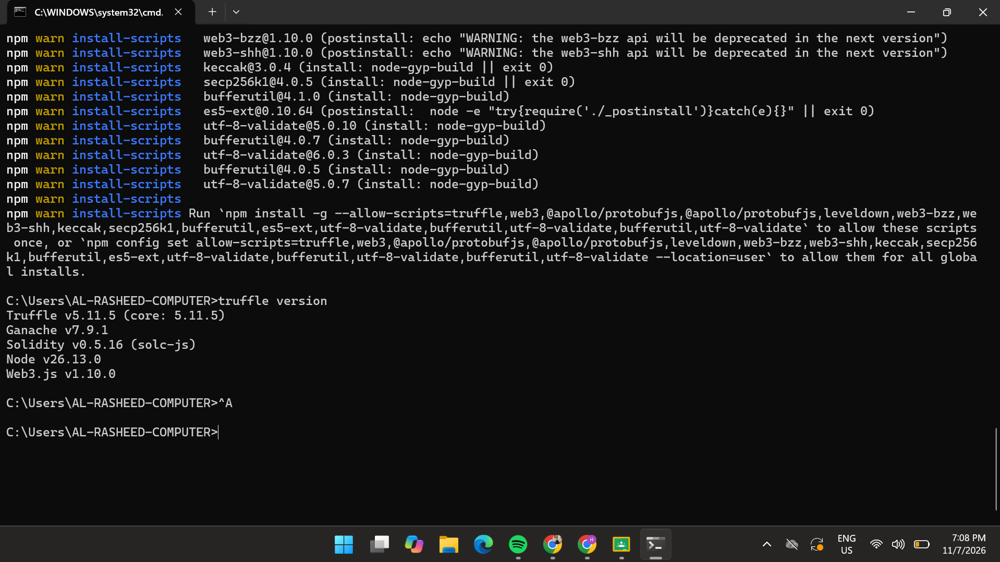
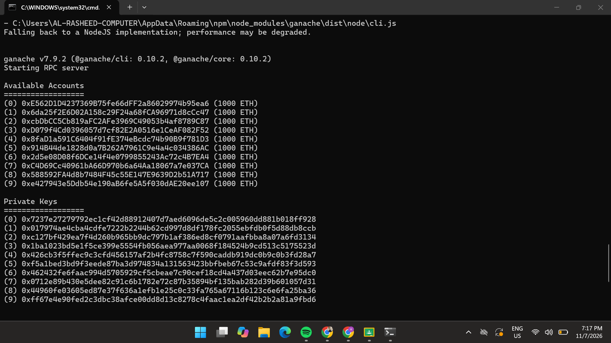
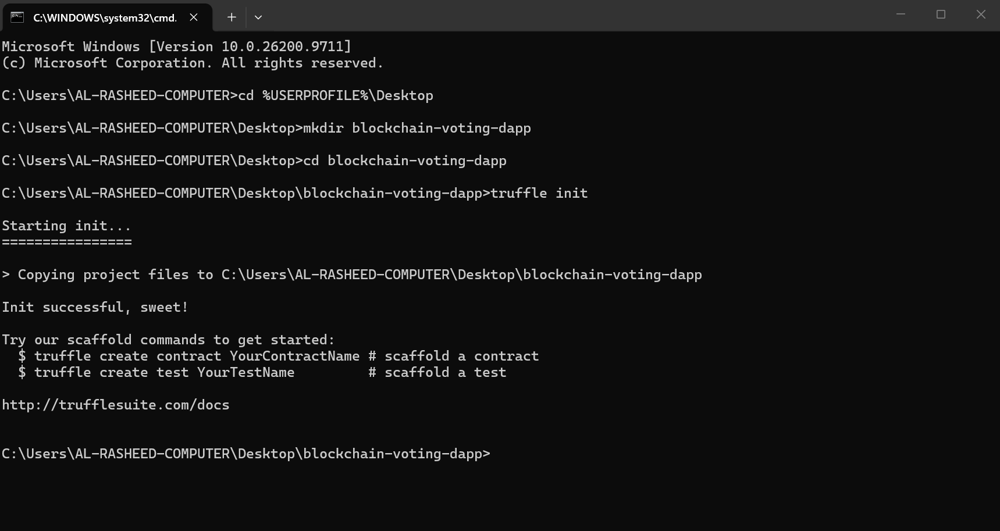

### Compile, deploy and test
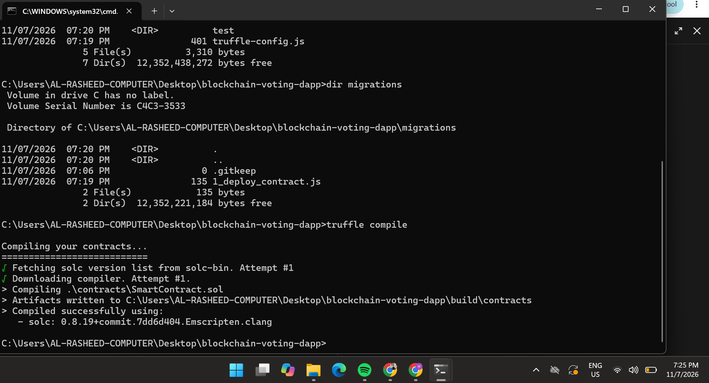
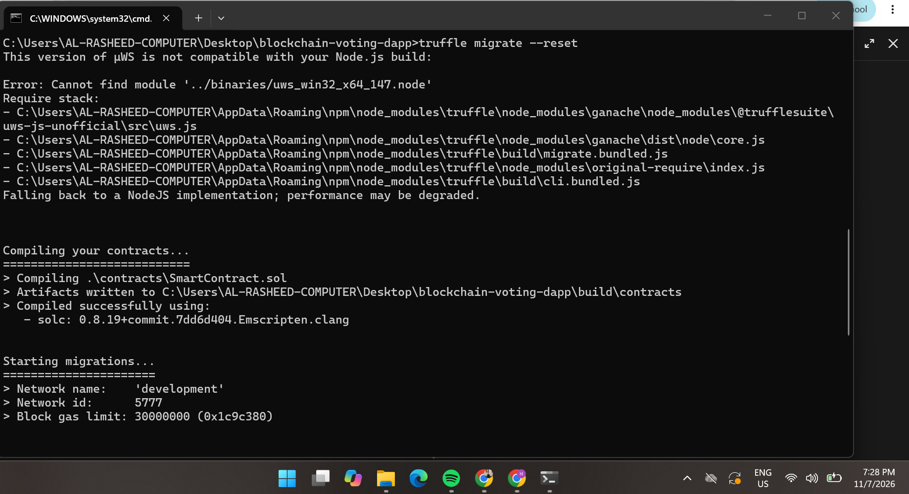
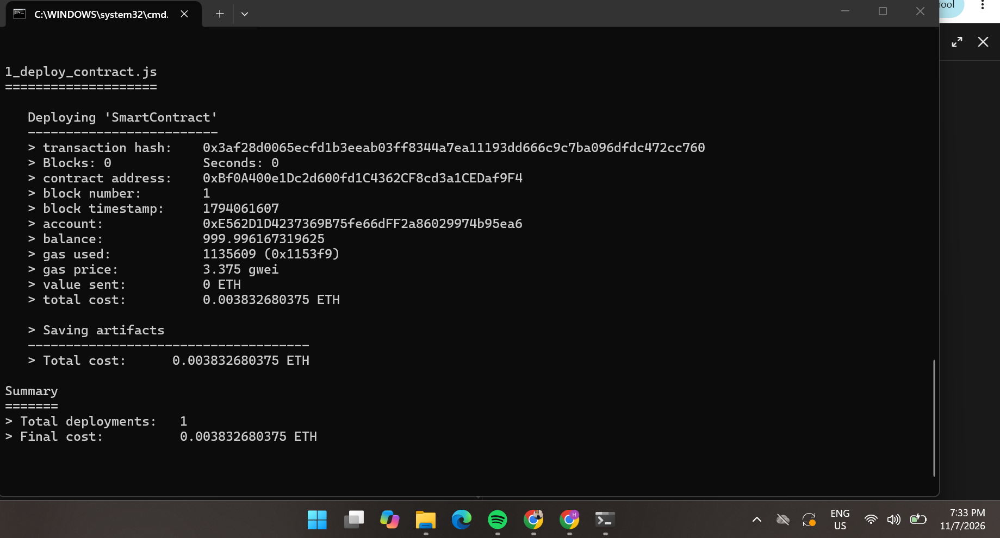
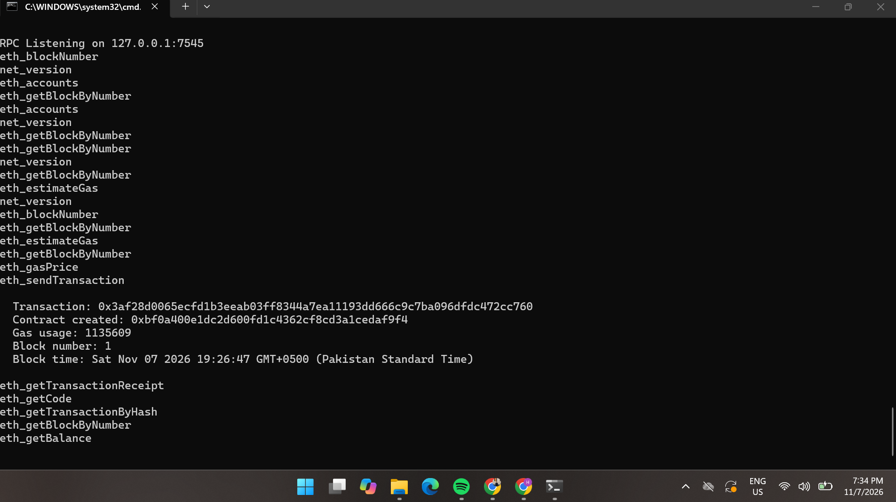
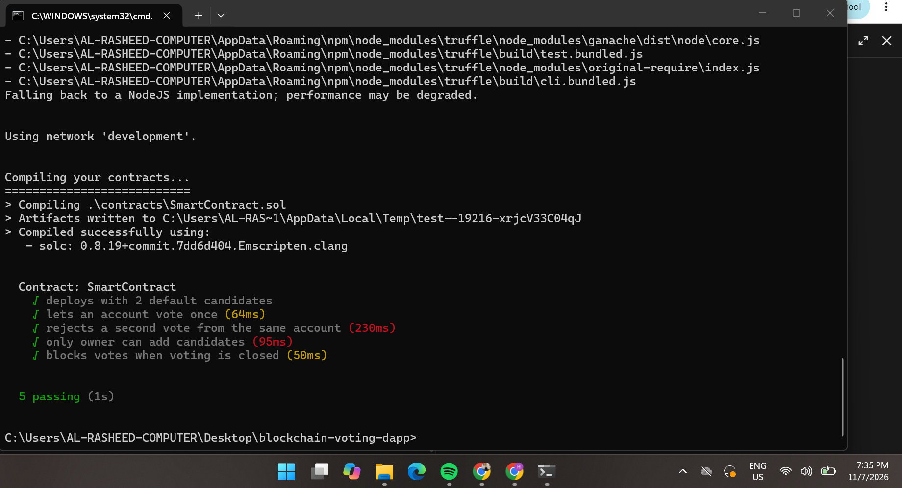

### dApp interaction
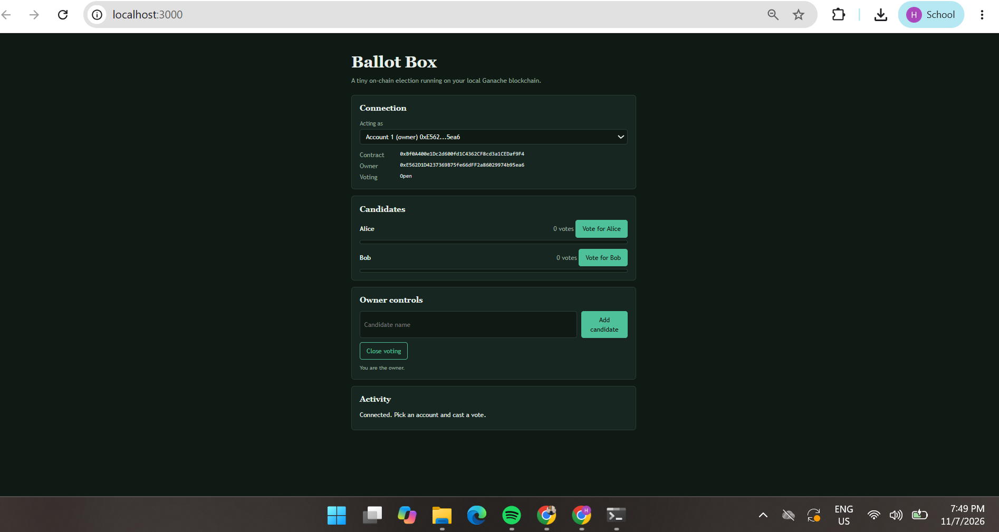
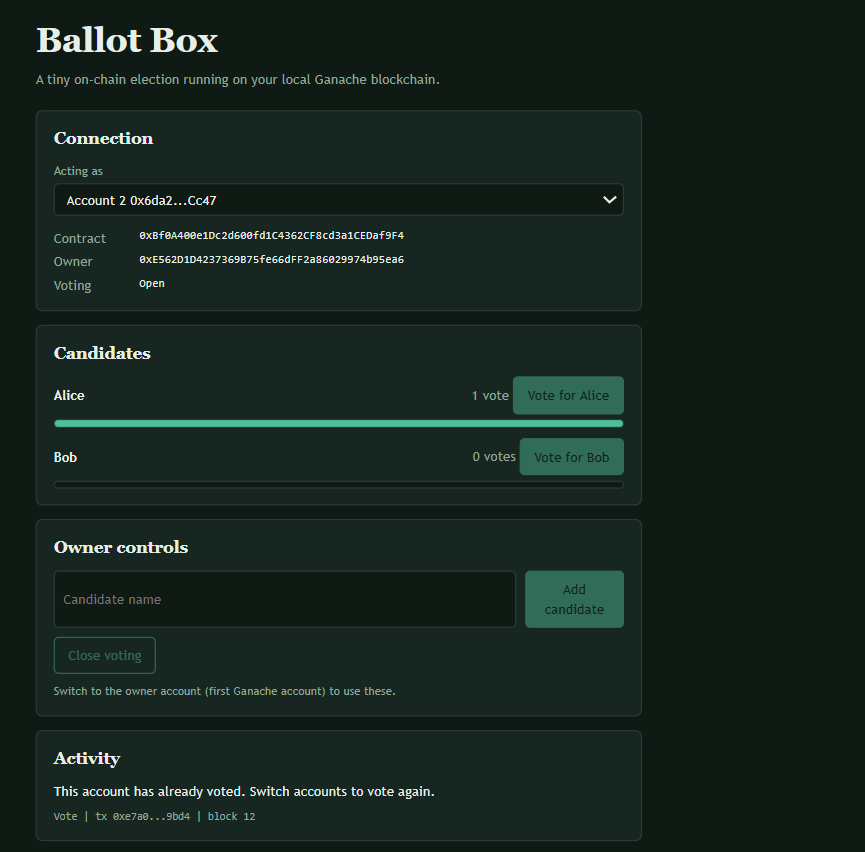
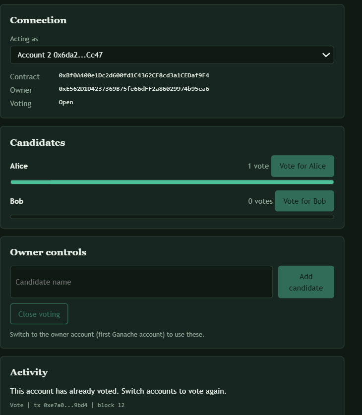
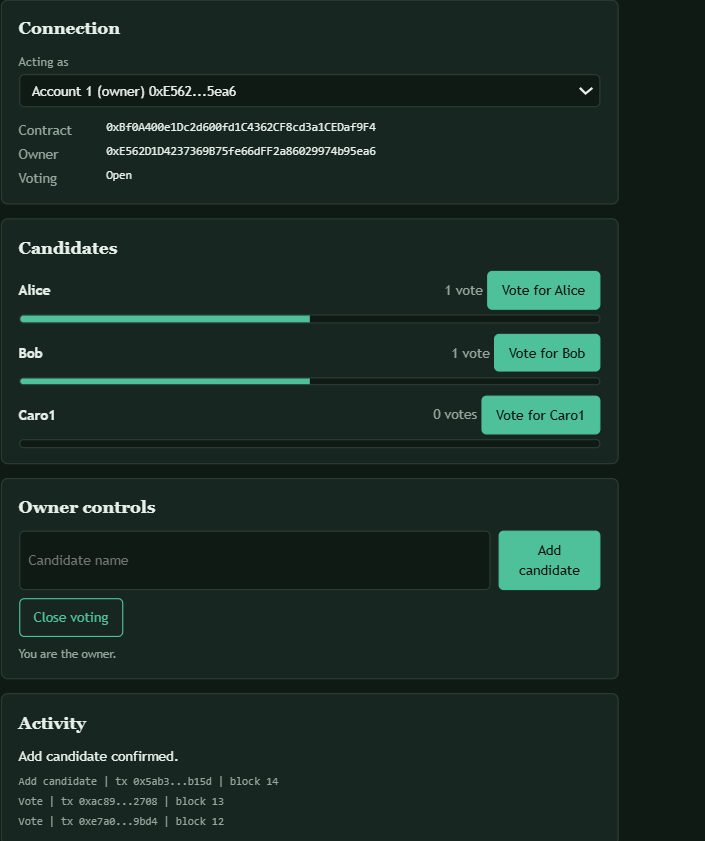
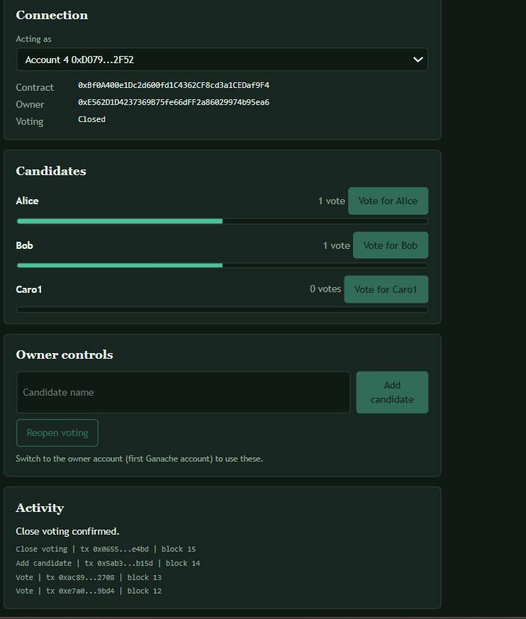
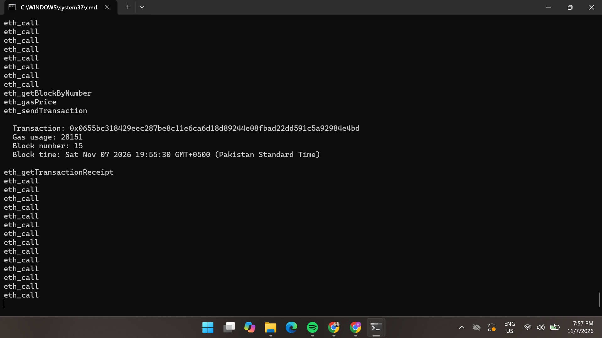
